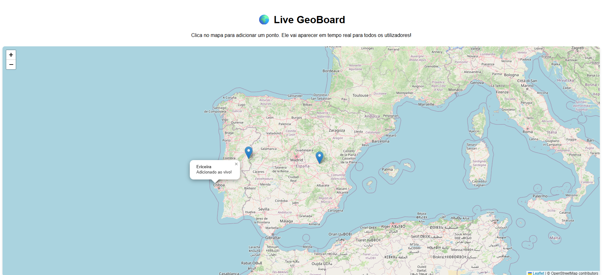

# 🌍 Live GeoBoard

Uma aplicação web em tempo real (Real-Time Web App) para marcação colaborativa de pontos geográficos, construída com a stack MEAN e WebSockets.

O **Live GeoBoard** permite que múltiplos utilizadores acedam simultaneamente a um mapa interativo. Qualquer ponto de interesse adicionado por um utilizador é instantaneamente propagado para todos os clientes ativos, garantindo um estado sincronizado em tempo real, enquanto persiste os dados na cloud de forma segura.

## ✨ Funcionalidades Principais

- **Sincronização em Tempo Real:** Comunicação bidirecional assíncrona utilizando WebSockets (`Socket.io`).
- **Persistência na Cloud:** Integração com MongoDB Atlas para armazenamento seguro de coordenadas e metadados.
- **Carregamento Assíncrono:** Consumo de REST API via `fetch` nativo no arranque da aplicação para carregar o histórico geográfico.
- **Client-Side Rendering Otimizado:** Construído em Angular 19+ (Standalone Components), com injeção de dependências otimizada.
- **Mapa Interativo:** Integração com a biblioteca de código aberto Leaflet.

## 🛠️ Stack Tecnológica

**Frontend:**
- [Angular](https://angular.dev/) (TypeScript, RxJS)
- [Leaflet](https://leafletjs.com/) (Visualização Geoespacial)
- [Socket.io-client](https://socket.io/)

**Backend:**
- [Node.js](https://nodejs.org/) & [Express](https://expressjs.com/) (Servidor Web & REST API)
- [Socket.io](https://socket.io/) (Motor WebSockets)
- [Mongoose](https://mongoosejs.com/) (Modelação de Dados / ODM)

**Base de Dados:**
- [MongoDB Atlas](https://www.mongodb.com/atlas) (Cloud NoSQL Database)

## 🏗️ Arquitetura e Fluxo de Dados

1. **Leitura (Init):** Quando um cliente abre o Angular, é feito um pedido `GET` (via HTTP/REST) ao Node.js. O Node.js consulta o MongoDB e devolve todo o histórico de pontos guardados para renderizar no mapa.
2. **Escrita (Real-time):** Quando o utilizador clica no mapa para adicionar um ponto, o Angular emite um evento via WebSocket.
3. **Persistência e Propagação:** O Node.js valida os dados com o Mongoose, guarda no MongoDB Atlas e faz *broadcast* imediato do novo ponto para todos os outros clientes conectados.

## 📋 Pré-requisitos

Garante que tens as seguintes ferramentas instaladas:
* [Git](https://git-scm.com)
* [Docker](https://www.docker.com/) e [Docker Compose](https://docs.docker.com/compose/)
* Uma conta no [MongoDB Atlas](https://www.mongodb.com/atlas/database) (ou o MongoDB a correr localmente)
* *Opcional: [Node.js](https://nodejs.org/) se quiseres correr os servidores manualmente sem Docker.*

## ⚙️ Configuração do Ambiente

Para que o backend consiga comunicar com a base de dados, precisas de configurar as tuas credenciais de acesso locais.

1. Navega até à pasta `server`.
2. Cria um ficheiro chamado `.env`.
3. Adiciona a tua *Connection String* do MongoDB com o seguinte formato:

```env
MONGO_URI=mongodb+srv://<TEU_USER>:<TUA_PASSWORD>@cluster0.abcde.mongodb.net/geoboard?retryWrites=true&w=majority
```

## 🐳 Como Executar com o Docker (Recomendado)

O projeto está otimizado com um *multi-stage build* que compila o Angular e o serve de forma super leve num contentor Nginx, enquanto orquestra o backend em simultâneo.

1. Abre o teu terminal na **raiz do projeto** (onde está o ficheiro `docker-compose.yml`).
2. Constrói e levanta os contentores em segundo plano:

```bash
docker-compose up --build -d
```
Acede à aplicação no teu navegador em: http://localhost:4200

Para veres os logs (registos) do servidor em tempo real:

```bash
docker-compose logs -f backend
```

Para parares a aplicação e desligares os contentores:

```bash
docker-compose down
```

## 🚀 Como Executar Localmente

### Pré-requisitos
- Node.js (v18+)
- Conta no MongoDB Atlas (Cluster gratuito / Tier M0)

### 1. Configurar o Backend (Servidor)
```bash
# Entrar na pasta do servidor
cd server

# Instalar dependências
npm install

# Criar o ficheiro de variáveis de ambiente
# Adiciona a tua string de conexão: MONGO_URI=mongodb+srv://<user>:<password>@cluster0...
touch .env

# Correr o servidor
node index.js
```
O servidor ficará a escutar na porta `3000`.

### 2. Configurar o Frontend (Angular)
Abra um **novo terminal** para manter o servidor a correr em simultâneo.

```bash
# Entrar na pasta do frontend
cd angular/live-geoboard

# Instalar dependências
npm install

# Correr a aplicação
npx ng serve -o
```
A aplicação abrirá automaticamente no navegador em `http://localhost:4200`.

## 📸 Demonstração



Um mural interativo onde os utilizadores podem registar pontos de interesse num mapa


## 🚀 Próximos Passos (Roadmap) ##

Login com utilizadores, autenticação, agrupamento de marcadores no mapa


## 👨‍💻 Autor

**Pedro Rosa**

[](https://www.linkedin.com/in/pedro-rosa-02208235a/)
[](https://github.com/pedrorosa3)