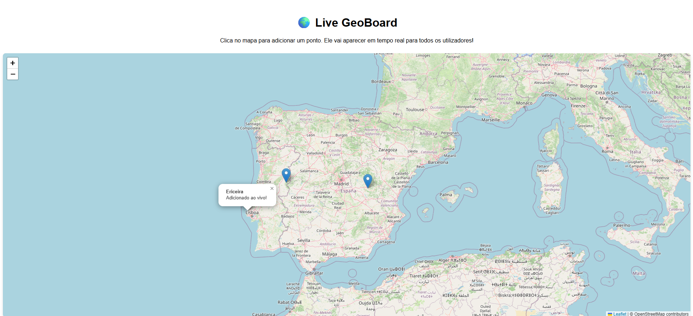
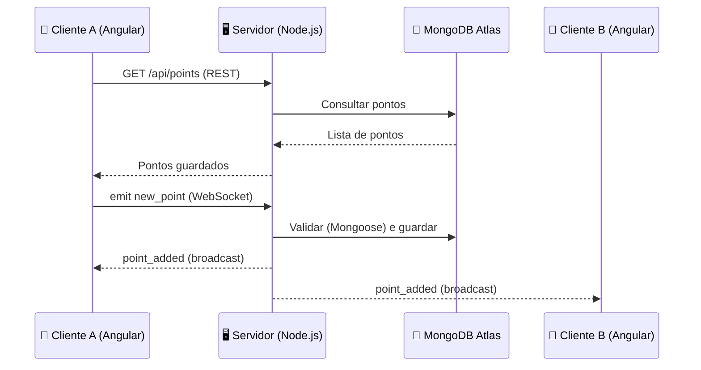

<div align="center">

# 🌍 Live GeoBoard

**Mapa colaborativo em tempo real para marcar pontos geográficos**

Cada ponto adicionado por um utilizador aparece de imediato no ecrã de todos os outros.


📅 **Novembro de 2026** · 👨‍💻 **Pedro Rosa**



</div>

---

## 📖 Índice

- [Sobre o Projeto](#-sobre-o-projeto)
- [Funcionalidades](#-funcionalidades)
- [Stack Tecnológica](#️-stack-tecnológica)
- [Arquitetura](#️-arquitetura)
- [Estrutura do Projeto](#-estrutura-do-projeto)
- [Como Executar](#-como-executar)
  - [Configuração do `.env`](#1-configurar-a-base-de-dados)
  - [Com Docker (recomendado)](#2a-executar-com-docker-recomendado)
  - [Sem Docker (manual)](#2b-executar-manualmente-sem-docker)
- [Roadmap](#-roadmap)
- [Autor](#-autor)

---

## 💡 Sobre o Projeto

O **Live GeoBoard** é uma aplicação web em tempo real construída com a stack **MEAN** (MongoDB, Express, Angular, Node.js) e **WebSockets**.

Vários utilizadores podem abrir o mesmo mapa interativo em simultâneo. Quando alguém clica no mapa para registar um ponto de interesse, esse ponto é guardado na cloud e enviado no mesmo instante para todos os clientes ligados, mantendo o mapa sincronizado para toda a gente.

## ✨ Funcionalidades

| | Funcionalidade | Descrição |
|---|---|---|
| ⚡ | **Tempo real** | Comunicação bidirecional via `Socket.io` |
| ☁️ | **Persistência na cloud** | Coordenadas e metadados guardados no MongoDB Atlas |
| 📜 | **Histórico ao arrancar** | Os pontos existentes são carregados por REST API (`fetch`) |
| 🧩 | **Angular moderno** | Standalone Components e injeção de dependências |
| 🗺️ | **Mapa interativo** | Renderizado com a biblioteca open source Leaflet |
| 🐳 | **Pronto para Docker** | Frontend e backend orquestrados com Docker Compose |

## 🛠️ Stack Tecnológica

| Camada | Tecnologias |
|---|---|
| **Frontend** | [Angular](https://angular.dev/) · TypeScript · RxJS · [Leaflet](https://leafletjs.com/) · [Socket.io-client](https://socket.io/) |
| **Backend** | [Node.js](https://nodejs.org/) · [Express](https://expressjs.com/) · [Socket.io](https://socket.io/) · [Mongoose](https://mongoosejs.com/) |
| **Base de Dados** | [MongoDB Atlas](https://www.mongodb.com/atlas) |
| **Infraestrutura** | [Docker](https://www.docker.com/) · Docker Compose · Nginx |

## 🏗️ Arquitetura



1. **Leitura:** ao abrir a aplicação, o Angular faz um pedido HTTP ao Node.js, que devolve todos os pontos guardados no MongoDB.
2. **Escrita:** ao clicar no mapa, o Angular emite um evento por WebSocket com as coordenadas.
3. **Propagação:** o Node.js valida os dados com o Mongoose, guarda-os no MongoDB Atlas e faz *broadcast* do novo ponto para todos os clientes ligados.

## 📁 Estrutura do Projeto

```
Live-GeoBoard/
├── angular/
│   └── live-geoboard/      # Frontend Angular
│       ├── src/app/
│       │   └── services/   # Serviço de WebSocket
│       └── Dockerfile      # Build multi-stage (Node → Nginx)
├── server/                 # Backend Node.js + Express + Socket.io
│   ├── index.js
│   └── Dockerfile
├── img/                    # Imagens do README
└── docker-compose.yml      # Orquestração dos contentores
```

## 🚀 Como Executar

### Pré-requisitos

- [Git](https://git-scm.com)
- [Docker](https://www.docker.com/) e [Docker Compose](https://docs.docker.com/compose/) *(para a opção com Docker)*
- [Node.js](https://nodejs.org/) v22.22+ ou v24.15+ *(exigido pelo Angular 22; para a opção manual)*
- Uma conta no [MongoDB Atlas](https://www.mongodb.com/atlas/database) (o cluster gratuito M0 chega) ou um MongoDB local

Começa por clonar o repositório:

```bash
git clone https://github.com/pedrorosa3/Live-GeoBoard.git
cd Live-GeoBoard
```

### 1. Configurar a base de dados

Cria um ficheiro `.env` dentro da pasta `server/` com a *connection string* do MongoDB:

```env
MONGO_URI=mongodb+srv://<UTILIZADOR>:<PASSWORD>@cluster0.xxxxx.mongodb.net/geoboard?retryWrites=true&w=majority
```

> [!WARNING]
> O ficheiro `.env` contém credenciais. Nunca o envies para o repositório.

### 2a. Executar com Docker (recomendado)

Na **raiz do projeto**, constrói e arranca os contentores:

```bash
docker-compose up --build -d
```

| Serviço | Endereço |
|---|---|
| 🌐 Frontend (Nginx) | http://localhost:4200 |
| 🖥️ Backend (API + WebSockets) | http://localhost:3000 |

Comandos úteis:

```bash
# Ver os logs do backend em tempo real
docker-compose logs -f backend

# Parar e remover os contentores
docker-compose down
```

### 2b. Executar manualmente (sem Docker)

São precisos **dois terminais**: um para o backend e outro para o frontend.

**Terminal 1 — Backend**

```bash
cd server
npm install
node index.js
```

O servidor fica a escutar na porta `3000`.

**Terminal 2 — Frontend**

```bash
cd angular/live-geoboard
npm install
npx ng serve -o
```

A aplicação abre automaticamente em http://localhost:4200.

## 🗺️ Roadmap

- [x] Mapa interativo com Leaflet
- [x] Sincronização em tempo real com WebSockets
- [x] Persistência no MongoDB Atlas
- [x] Dockerização do frontend e do backend
- [ ] Registo e login de utilizadores
- [ ] Autenticação nas rotas e nos eventos de socket
- [ ] Agrupamento de marcadores (*clustering*) no mapa

## 👨‍💻 Autor

<div align="center">

**Pedro Rosa**

[](https://www.linkedin.com/in/pedro-rosa-02208235a/)
[](https://github.com/pedrorosa3)

<sub>Desenvolvido em novembro de 2026</sub>

</div>
