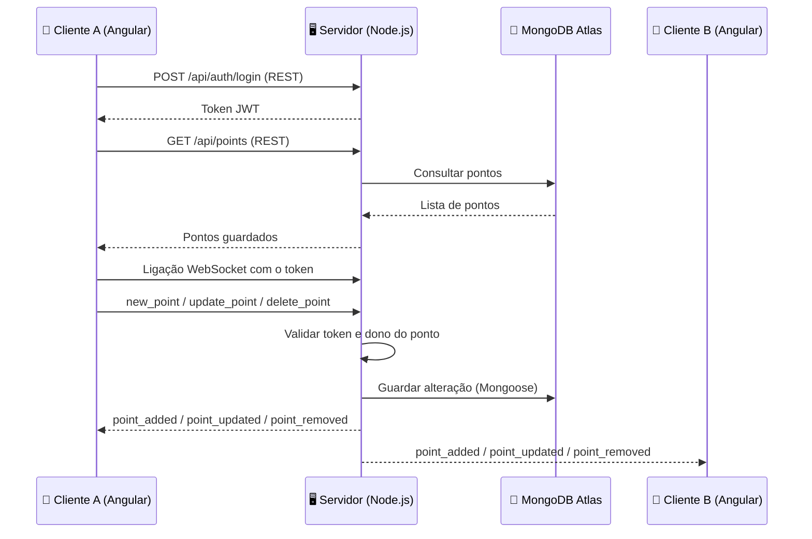

<div align="center">

# 🌍 Live GeoBoard

**Mapa colaborativo em tempo real para marcar pontos geográficos**

Cada ponto adicionado, editado ou removido aparece de imediato no ecrã de todos os outros utilizadores.


📅 **Novembro de 2026** · 👨‍💻 **Pedro Rosa**


</div>

---

## 📖 Índice

- [Sobre o Projeto](#-sobre-o-projeto)
- [Funcionalidades](#-funcionalidades)
- [Stack Tecnológica](#️-stack-tecnológica)
- [Arquitetura](#️-arquitetura)
- [Estrutura do Projeto](#-estrutura-do-projeto)
- [Como Executar](#-como-executar)
  - [Configuração do `.env`](#1-configurar-o-ficheiro-env)
  - [Com Docker (recomendado)](#2a-executar-com-docker-recomendado)
  - [Sem Docker (manual)](#2b-executar-manualmente-sem-docker)
- [Como Usar](#-como-usar)
- [Roadmap](#-roadmap)
- [Autor](#-autor)

---

## 💡 Sobre o Projeto

O **Live GeoBoard** é uma aplicação web em tempo real construída com a stack **MEAN** (MongoDB, Express, Angular, Node.js) e **WebSockets**.

Vários utilizadores podem abrir o mesmo mapa interativo em simultâneo. Quando alguém clica no mapa para registar um ponto de interesse, esse ponto é guardado na cloud e enviado no mesmo instante para todos os clientes ligados, mantendo o mapa sincronizado para toda a gente.

Qualquer pessoa pode ver o mapa, mas para criar pontos é preciso uma conta. Cada ponto fica associado a quem o criou, e só essa pessoa o pode **editar** (nome e cor) ou **remover**.

## ✨ Funcionalidades

| | Funcionalidade | Descrição |
|---|---|---|
| ⚡ | **Tempo real** | Criação, edição e remoção de pontos propagadas via `Socket.io` |
| 🔐 | **Contas de utilizador** | Registo e login com passwords cifradas (bcrypt) e sessões JWT |
| 🛡️ | **Permissões por ponto** | Só o autor de um ponto o pode editar ou remover; o servidor valida cada pedido |
| 🎨 | **Pontos com cor** | Cada ponto tem um nome e uma cor, editáveis pelo autor |
| ☁️ | **Persistência na cloud** | Coordenadas e metadados guardados no MongoDB Atlas |
| 📜 | **Histórico ao arrancar** | Os pontos existentes são carregados por REST API (`fetch`) |
| 🧩 | **Angular moderno** | Standalone Components e injeção de dependências |
| 🗺️ | **Mapa interativo** | Renderizado com a biblioteca open source Leaflet |
| 🐳 | **Pronto para Docker** | Frontend e backend orquestrados com Docker Compose |

## 🛠️ Stack Tecnológica

| Camada | Tecnologias |
|---|---|
| **Frontend** | [Angular](https://angular.dev/) · TypeScript · RxJS · [Leaflet](https://leafletjs.com/) · [Socket.io-client](https://socket.io/) |
| **Backend** | [Node.js](https://nodejs.org/) · [Express](https://expressjs.com/) · [Socket.io](https://socket.io/) · [Mongoose](https://mongoosejs.com/) · [bcryptjs](https://github.com/dcodeIO/bcrypt.js) · [jsonwebtoken](https://github.com/auth0/node-jsonwebtoken) |
| **Base de Dados** | [MongoDB Atlas](https://www.mongodb.com/atlas) |
| **Infraestrutura** | [Docker](https://www.docker.com/) · Docker Compose · Nginx |

## 🏗️ Arquitetura



1. **Autenticação:** o utilizador regista-se ou entra com `POST /api/auth/register` ou `POST /api/auth/login` e recebe um token JWT (válido 7 dias), que o Angular guarda no browser e envia ao ligar o WebSocket.
2. **Leitura:** ao abrir a aplicação, o Angular faz um pedido HTTP ao Node.js, que devolve todos os pontos guardados no MongoDB.
3. **Escrita:** ao criar, editar ou remover um ponto, o Angular emite um evento por WebSocket. Sem sessão iniciada, a ligação é só de leitura.
4. **Permissões:** o Node.js confirma que o token é válido e, para editar ou remover, que o ponto pertence a esse utilizador.
5. **Propagação:** a alteração é guardada no MongoDB Atlas e enviada (*broadcast*) para todos os clientes ligados.

| Evento (cliente → servidor) | Requer | Evento enviado a todos |
|---|---|---|
| `new_point` | Sessão iniciada | `point_added` |
| `update_point` | Ser o autor do ponto | `point_updated` |
| `delete_point` | Ser o autor do ponto | `point_removed` |

> [!NOTE]
> Os pontos criados antes de existirem contas não têm autor, por isso ninguém os pode editar nem remover pela aplicação.

## 📁 Estrutura do Projeto

```
Live-GeoBoard/
├── angular/
│   └── live-geoboard/      # Frontend Angular
│       ├── src/app/
│       │   ├── app.ts      # Mapa, login e editor de pontos
│       │   └── services/   # Autenticação (auth.ts) e WebSocket (socket.ts)
│       └── Dockerfile      # Build multi-stage (Node → Nginx)
├── server/                 # Backend Node.js + Express + Socket.io
│   ├── index.js            # API REST, autenticação, modelos e eventos de socket
│   └── Dockerfile
├── img/                    # Imagens do README
└── docker-compose.yml      # Orquestração dos contentores
```

## 🚀 Como Executar

### Pré-requisitos

- [Git](https://git-scm.com)
- [Docker](https://www.docker.com/) e [Docker Compose](https://docs.docker.com/compose/) *(para a opção com Docker)*
- [Node.js](https://nodejs.org/) v22.22+ ou v24.15+ *(exigido pelo Angular 22; para a opção manual)*
- Uma conta no [MongoDB Atlas](https://www.mongodb.com/atlas/database) (o cluster gratuito M0 chega) ou um MongoDB local

Começa por clonar o repositório:

```bash
git clone https://github.com/pedrorosa3/Live-GeoBoard.git
cd Live-GeoBoard
```

### 1. Configurar o ficheiro `.env`

Cria um ficheiro `.env` dentro da pasta `server/` com a *connection string* do MongoDB e uma chave secreta para assinar os tokens de sessão:

```env
MONGO_URI=mongodb+srv://<UTILIZADOR>:<PASSWORD>@cluster0.xxxxx.mongodb.net/geoboard?retryWrites=true&w=majority
JWT_SECRET=uma_frase_longa_e_aleatoria
```

Para gerar uma chave aleatória:

```bash
node -e "console.log(require('crypto').randomBytes(48).toString('hex'))"
```

Se faltar o `JWT_SECRET`, o servidor não arranca.

> [!WARNING]
> O ficheiro `.env` contém credenciais. Nunca o envies para o repositório.

### 2a. Executar com Docker (recomendado)

Na **raiz do projeto**, constrói e arranca os contentores:

```bash
docker-compose up --build -d
```

| Serviço | Endereço |
|---|---|
| 🌐 Frontend (Nginx) | http://localhost:4200 |
| 🖥️ Backend (API + WebSockets) | http://localhost:3000 |

Comandos úteis:

```bash
# Ver os logs do backend em tempo real
docker-compose logs -f backend

# Parar e remover os contentores
docker-compose down
```

### 2b. Executar manualmente (sem Docker)

São precisos **dois terminais**: um para o backend e outro para o frontend.

**Terminal 1 — Backend**

```bash
cd server
npm install
node index.js
```

O servidor fica a escutar na porta `3000`.

**Terminal 2 — Frontend**

```bash
cd angular/live-geoboard
npm install
npx ng serve -o
```

A aplicação abre automaticamente em http://localhost:4200.

## 🧭 Como Usar

1. **Cria uma conta:** no topo da página, escreve um nome de utilizador (3 a 30 caracteres) e uma password (mínimo 6) e carrega em **Criar conta**. Da próxima vez, usa **Entrar**. A sessão fica guardada no browser durante 7 dias.
2. **Adiciona um ponto:** clica em qualquer sítio do mapa, dá-lhe um nome, escolhe uma cor e carrega em **Guardar**.
3. **Edita ou remove:** clica num dos teus pontos para abrir o popup e usa **Editar** ou **Remover**. Nos pontos de outras pessoas só aparece o nome do autor.
4. **Vê em tempo real:** abre a aplicação noutra janela ou noutro computador. As alterações aparecem nas duas sem recarregar a página.

> [!TIP]
> Sem sessão iniciada podes ver o mapa e os pontos de toda a gente, mas não podes alterar nada.

## 🗺️ Roadmap

- [x] Mapa interativo com Leaflet
- [x] Sincronização em tempo real com WebSockets
- [x] Persistência no MongoDB Atlas
- [x] Dockerização do frontend e do backend
- [x] Registo e login de utilizadores
- [x] Autenticação nos eventos de socket
- [x] Edição e remoção de pontos pelo autor
- [ ] Agrupamento de marcadores (*clustering*) no mapa

## 👨‍💻 Autor

<div align="center">

**Pedro Rosa**

[](https://www.linkedin.com/in/pedro-rosa-02208235a/)
[](https://github.com/pedrorosa3)

<sub>Desenvolvido em novembro de 2026</sub>

</div>
